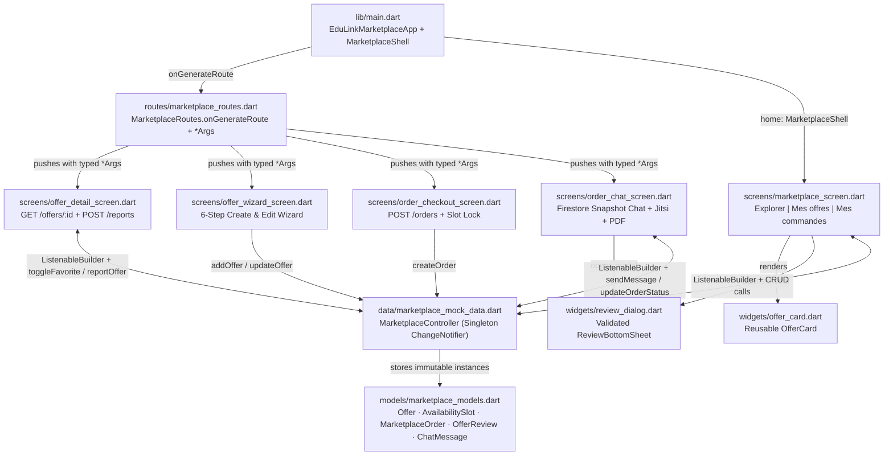

# EduLink (M5 · Marketplace) — Complete Component & Code Architecture Defense Guide

> **Purpose of this guide:** Prepare you to answer **any technical question** your professor asks during the interface evaluation. Every library, widget, route, validation rule, state listener, and code connection in your `marketplace` branch is documented below.

---

## 1. Libraries & Packages Used (and Why)

Your Marketplace module uses **100% official Flutter SDK libraries** (zero unnecessary third-party UI packages), which guarantees fast compilation, Material 3 compliance, and zero dependency conflicts when merging with your teammates.

| Import Statement | Where Used | What It Provides | Why We Used It |
| :--- | :--- | :--- | :--- |
| `package:flutter/material.dart` | All screens, widgets, routes, and models | Material Design 3 widgets (`MaterialApp`, `Scaffold`, `NavigationBar`, `SegmentedButton`, `Form`, `TextFormField`, `Card`, `Chip`s, `AlertDialog`, `ModalBottomSheet`), `Navigator`, `ThemeData`, `Color`, `IconData`. | Gives native Material 3 styling (`useMaterial3: true`), accessibility, ripple animations, and built-in form validation. |
| `package:flutter/foundation.dart` | `lib/features/marketplace/data/marketplace_mock_data.dart` | `ChangeNotifier` (`notifyListeners()`). | Implements the **Observer Pattern** for state management in the data layer *without* importing UI widgets into business logic, and is 100% compatible with `Provider`. |
| `dart:core` *(implicit)* | All files | Enhanced `enum`s, `RegExp`, `DateTime`, `List.unmodifiable`, `Set.unmodifiable`, Dart 3 Records `(a, b)`. | Enforces type safety, immutability, and strict `HH:mm` / numeric regex validation. |
| `package:flutter_test/flutter_test.dart` | `test/widget_test.dart` | `testWidgets`, `WidgetTester`, `find`, `expect`. | Automated smoke test proving the interface renders with zero layout overflows (`RenderFlex`). |

---

## 2. How All 10 Files Connect Together (Architecture Map)

### Trace of a Complete User Journey in Code
1. **App Launch**: `main()` calls `runApp(const EduLinkMarketplaceApp())`, which registers `MarketplaceRoutes.onGenerateRoute` and mounts `MarketplaceShell`.
2. **Browsing Catalogue**: `MarketplaceShell` renders `MarketplaceScreen`, which reads `MarketplaceController.instance.allOffers` and displays each offer using `OfferCard`.
3. **Opening Offer Detail**: Tapping an `OfferCard` fires its `onTap` callback -> calls `Navigator.pushNamed(context, MarketplaceRoutes.offerDetail, arguments: OfferDetailArgs(offerId: offer.id))` -> `onGenerateRoute` builds `OfferDetailScreen`.
4. **Auto View Counter**: `OfferDetailScreen.initState()` calls `_controller.incrementViewCount(widget.offerId)` after the first frame via `addPostFrameCallback`.
5. **Booking / Ordering**: Tapping *"Réserver / Commander"* pushes `MarketplaceRoutes.orderCheckout` with `OrderCheckoutArgs` (passing both the `Offer` and any preselected `AvailabilitySlot`).
6. **Validating & Locking**: `OrderCheckoutScreen._confirmOrder()` runs `_formKey.currentState!.validate()`, calls `_controller.createOrder(...)` (locking the slot `isBooked = true`), and calls `Navigator.pushReplacementNamed` to open `OrderChatScreen`.
7. **Status Lifecycle & Review**: Inside `OrderChatScreen`, accepting generates a Jitsi Meet link (`https://meet.jit.si/edulink-...`) or unlocks the private Cloudinary PDF. Marking as `completed` unlocks `ReviewBottomSheet`, which validates the comment and calls `_controller.submitReview(...)` to recalculate `ratingAvg`.

---

## 3. Master Catalog of Every Flutter Component Used

### A. App Root, Structure & Navigation Shell (`package:flutter/material.dart`)

| Component | Where Used in Code | What It Does | Why We Chose It & How It Links |
| :--- | :--- | :--- | :--- |
| **`MaterialApp`** | `EduLinkMarketplaceApp` (`lib/main.dart`) | Root Material container configuring theme, title, initial route, and route generator. | Required root for Material 3 apps; hosts the top-level `Navigator` connected to `MarketplaceRoutes.onGenerateRoute`. |
| **`ThemeData` & `ColorScheme.fromSeed`** | `EduLinkMarketplaceApp` (`lib/main.dart`) | Generates a harmonious Material 3 color palette from seed color `#2563EB`. | Guarantees **Criterion 1 (Charte graphique)** across all buttons, inputs, chips, and dialogs automatically. |
| **`Scaffold`** | `MarketplaceShell` + all 5 screens | Provides the standard screen skeleton (`appBar`, `body`, `floatingActionButton`, `bottomNavigationBar`). | Ensures consistent mobile ergonomics and hosts `SnackBar` notifications via `ScaffoldMessenger`. |
| **`AppBar`** | `MarketplaceShell` + pushed screens | Top header bar displaying screen title, automatic back arrow (`<-`), and action buttons. | Automatically displays a back button when a route is pushed via `Navigator.pushNamed`. |
| **`NavigationBar` & `NavigationDestination`** | `MarketplaceShell` (`lib/main.dart`) | Material 3 bottom navigation bar with the 5 EduLink tabs (`Cours`, `Forum`, `Évaluations`, `Marketplace`, `Profil`). | Replaces the deprecated Material 2 `BottomNavigationBar`; highlights index `3` (`Marketplace`) and shows an informative `SnackBar` for other branches' tabs. |
| **`SafeArea`** | `OrderCheckoutScreen`, `OrderChatScreen`, `OfferDetailScreen`, `OfferWizardScreen` | Adds padding to avoid Android gesture bars, notches, and system status bars. | Prevents bottom action bars and chat inputs from colliding with the phone's home indicator bar. |

---

### B. State Management, Lifecycle & Modals (`foundation.dart` & `material.dart`)

| Component | Where Used in Code | What It Does | Why We Chose It & How It Links |
| :--- | :--- | :--- | :--- |
| **`ChangeNotifier`** | `MarketplaceController` (`marketplace_mock_data.dart`) | Observable base class from `flutter/foundation.dart` with `notifyListeners()`. | Decouples business logic from UI; every CRUD action notifies all listening screens at once. |
| **`ListenableBuilder`** | `MarketplaceShell`, `MarketplaceScreen`, `OfferDetailScreen`, `OrderChatScreen` | Rebuilds its `builder` subtree whenever `MarketplaceController.instance` fires `notifyListeners()`. | Native Flutter reactive widget—eliminates manual `addListener`/`removeListener` boilerplate. |
| **`StatefulBuilder`** | Filter sheet (`MarketplaceScreen`), Report dialog (`OfferDetailScreen`) | Provides a local `setModalState` callback inside dialogs and bottom sheets. | Dialogs/sheets live in a separate overlay route, so calling the parent screen's `setState` alone wouldn't refresh the slider or radio buttons inside the open modal. |
| **`WidgetsBinding.instance .addPostFrameCallback`** | `OfferDetailScreen.initState`, `OrderChatScreen.initState` | Schedules a callback right *after* the first UI frame finishes painting. | Safely calls `incrementViewCount()` and `markConversationRead()` (which call `notifyListeners()`) without triggering a *"markNeedsBuild called during build"* exception. |
| **`MediaQuery.of(context) .viewInsets.bottom`** | `ReviewBottomSheet`, Slot modal (`MarketplaceScreen`) | Reads the exact pixel height of the open on-screen keyboard. | Pushes the modal bottom sheet *above* the phone's keyboard when typing a review or slot time. |

---

### C. Multi-View Switching & Scrolling Containers (`package:flutter/material.dart`)

| Component | Where Used in Code | What It Does | Why We Chose It & How It Links |
| :--- | :--- | :--- | :--- |
| **`SegmentedButton<T>` & `ButtonSegment<T>`** | Top bar in `MarketplaceScreen`, Mode selector in `OfferWizardScreen` | Material 3 multi-segment toggle button (`Explorer | Mes offres | Mes commandes`, and `En ligne | En présentiel`). | Implements the exact 3-view top switcher required on Page 8 of the Team Plan with clear visual selection state. |
| **`IndexedStack`** | `MarketplaceScreen` | Keeps all child views mounted in memory while painting only the child at `index: _topSectionIndex`. | Preserves the user's scroll position in *Explorer* when switching to *Mes offres* and back. |
| **`ListView` / `ListView.builder` / `ListView.separated`** | All screens; horizontal L6 carousel (`MarketplaceScreen`); chat messages (`OrderChatScreen`) | Scrollable linear list (`builder` builds items lazily on demand; `separated` inserts fixed gaps between items). | `ListView.separated` with `scrollDirection: Axis.horizontal` creates the L6 Recommended Offers carousel; `ListView.builder` scales efficiently to long chat histories. |
| **`SingleChildScrollView`** | Quick filter chips (`MarketplaceScreen`), Report dialog (`OfferDetailScreen`) | Makes a single Row or Column scrollable horizontally or vertically. | Prevents horizontal overflow on filter chip bars and vertical overflow when the keyboard opens inside `AlertDialog`. |
| **`DraggableScrollableSheet`** | Advanced filter sheet (`MarketplaceScreen`) | Bottom sheet that the user can drag between `minChildSize: 0.5`, `initialChildSize: 0.82`, and `maxChildSize: 0.92`. | Lets users comfortably scroll through all 7 filter criteria on small phone screens and swipe down to dismiss. |
| **`ScrollController`** | `OrderChatScreen` | Programmatically controls and animates the scroll offset of a `ListView`. | Calls `_scrollController.animateTo(maxScrollExtent)` after sending a message so the newest chat bubble smoothly scrolls into view. |

---

### D. Forms, Inputs & Validation Controls (`package:flutter/material.dart`)

| Component | Where Used in Code | What It Does | Validation Rules Enforced |
| :--- | :--- | :--- | :--- |
| **`Form` & `GlobalKey<FormState>`** | `OfferWizardScreen` (3 keys + slot dialog key), `OrderCheckoutScreen`, `ReviewBottomSheet`, `OfferDetailScreen`, `MarketplaceScreen` | Groups multiple form fields together so `_formKey.currentState!.validate()` validates every field simultaneously. | Blocks navigation/submission and displays red helper messages under invalid fields if any `validator` returns a non-null `String`. |
| **`TextFormField`** | Wizard Steps 2, 3, 4 & Slot dialogs; Checkout note; Review comment; Report "Other" reason | Material text input integrated with `Form` (`validator`, `maxLength`, `keyboardType`, `InputDecoration`). | - **Offer Title**: required, `5–80` chars, not all digits (`^\d+$` rejected) - **Description**: required, `20–600` chars - **Price (TND)**: numeric `double.tryParse`, `> 0` and `<= 500 TND` - **Address**: required, `>= 6` chars - **Slot Time**: `RegExp(r'^([01]\d\|2[0-3]):[0-5]\d$')` and `end > start` - **Order Note**: required, `10–300` chars - **Review Comment**: required, `10–300` chars |
| **`TextField`** | Search bar (`MarketplaceScreen`), Chat bar (`OrderChatScreen`) | Lightweight instant text input (`onChanged` / `onSubmitted`) outside a formal submission form. | Ideal for real-time keyword search filtering and instant chat messaging. |
| **`TextEditingController`** | Paired with every `TextFormField` and `TextField` | Reads/writes input text and pre-populates fields in Edit mode (`initState`). | Always disposed in `dispose()` to prevent memory leaks. |
| **`DropdownButtonFormField<String>`** | Step 2 (`subject`, `level`) & Step 4 (`city`) in `OfferWizardScreen` | Material dropdown menu styled with `InputDecoration` inside a `Form`. | Prevents typos by restricting subjects, academic levels (`L1`–`M2`), and Tunisian cities to valid schema values. |
| **`SwitchListTile`** | Step 3 (`_isFree`) in `OfferWizardScreen` | Full-width tappable row with title, subtitle, and Material 3 toggle switch. | Toggles *"Offre gratuite (0 TND)"* and dynamically hides/bypasses the price `TextFormField` when enabled. |
| **`RadioGroup<T>` & `RadioListTile<T>`** | Step 5 L6 course link (`OfferWizardScreen`), Report dialog (`OfferDetailScreen`) | Mutually exclusive single-choice list items using Flutter's modern non-deprecated `RadioGroup` API. | Ensures clean single-selection of either an optional linked course (`courseId`) or a report reason. |
| **`Slider`** | Advanced filter sheet (`MarketplaceScreen`) | Interactive range thumb (`0` to `100 TND`, `divisions: 20`). | Ergonomic way to filter offers by maximum price (`0 TND` = free offers only). |

---

### E. Chips, Badges, Buttons & Overlays (`package:flutter/material.dart`)

| Component | Where Used in Code | What It Does | Why We Chose It |
| :--- | :--- | :--- | :--- |
| **`FilterChip`** | Quick filter bar in `MarketplaceScreen` | Toggleable filter pill showing a checkmark when active. | Material 3 standard for multi-criteria catalog filtering (`Numérique`, `Physique`, `Cours 1h`, `Enseignant vérifié`). |
| **`ChoiceChip`** | Filter modal, status filters, slot chips in `OfferDetailScreen` | Single-choice selection pill (disabled automatically when `onSelected: null`). | Used for `AvailabilitySlot` selection: booked slots pass `onSelected: null`, visually graying them out. |
| **`ActionChip`** | Role switcher in `MarketplaceShell`, Add Photo in `OfferWizardScreen` | Compact pill button that triggers an immediate action on tap. | Lets you switch between `Étudiant` and `Enseignant vérifié` in 1 tap right from the `AppBar` during your demo. |
| **`Chip` (`onDeleted`)** | Uploaded photos list in `OfferWizardScreen` | Displays an item with a built-in `x` delete icon. | Lets sellers remove uploaded Cloudinary preview images cleanly. |
| **`Badge`** | `SegmentedButton` pending requests, Filter button count, Chat unread count | Material 3 notification counter dot overlaid on an icon or button. | Displays live unread chat counts (`order.unreadCount`), active filter counts (`_activeFiltersCount`), and pending seller orders. |
| **`FilledButton` / `.icon` / `.tonalIcon`** | Primary CTAs across all screens (`Réserver`, `Publier`, `Accepter`, `Envoyer`) | High-emphasis Material 3 primary button. | Used strictly for the main positive action of each screen; automatically grays out when `onPressed: null` (Rule 5 own-offer guard). |
| **`OutlinedButton` / `TextButton` / `IconButton`** | Secondary actions (`Modifier`, `Masquer`, `Créneaux`, `Refuser`, `Annuler`) | Medium- and low-emphasis Material 3 buttons (including `.filledTonal` and `.outlined` variants). | Establishes clear visual hierarchy so primary actions stand out from secondary CRUD controls. |
| **`FloatingActionButton.extended`** | *Mes offres* view in `MarketplaceScreen` | Floating primary button with `+` icon and *"Nouvelle offre"* label. | Appears contextually *only* when `_topSectionIndex == 1` (*Mes offres*) to launch the Offer Wizard. |
| **`Card` + `InkWell`** | `OfferCard` (`offer_card.dart`) | Rounded Material surface (`16px` radius) with touch ripple feedback (`InkWell`). | Reusable across both the vertical Explorer feed and the horizontal L6 Recommended Offers carousel (`compact: true`). |
| **`Wrap` + `Expanded` + `Flexible`** | Badges, metadata chips, action bars across all cards/screens | `Wrap` flows children onto the next line when horizontal space runs out; `Expanded`/`Flexible` constrain text with `TextOverflow.ellipsis`. | Guarantees **zero `RenderFlex` overflow errors** on any screen width (verified by `flutter test`). |
| **`AlertDialog` (`showDialog`)** | Delete confirmation (`MarketplaceScreen`), Report offer (`OfferDetailScreen`), Add slot (`OfferWizardScreen`) | Modal center dialog interrupting the flow for critical confirmations or focused mini-forms. | Protects destructive actions (`DELETE /offers/:id`) and encapsulates focused sub-forms (`POST /reports`, add slot). |
| **`showModalBottomSheet`** | Filters, Slot CRUD, `ReviewBottomSheet` | Slides an interactive sheet up from the bottom of the screen (`isScrollControlled: true`). | Keeps the user in context while filtering, managing slots, or rating a completed order (`1–5 ★`). |
| **`SnackBar` (`ScaffoldMessenger`)** | Confirmations & validation alerts across all screens | Temporary floating toast bar at the bottom of the `Scaffold`. | Gives immediate user feedback after publishing, editing, deleting, reporting, downloading a PDF, or failing form validation. |

---

## 4. Oral Defense Q&A — 12 Questions the Teacher Might Ask (with Exact Answers)

1. **"Which library did you use to build the UI, and did you enable Material 3?"**
   > *"We used Flutter's official `package:flutter/material.dart` with `useMaterial3: true` inside `ThemeData` and `ColorScheme.fromSeed(seedColor: Color(0xFF2563EB))` in `lib/main.dart`. For reactive state management in the data layer, we imported only `package:flutter/foundation.dart` for `ChangeNotifier` so the business logic stays decoupled from UI widgets."*

2. **"How is your navigation structured? Did you hardcode routes inside widgets?"**
   > *"No, all routes are centralized in `lib/features/marketplace/routes/marketplace_routes.dart` inside `MarketplaceRoutes.onGenerateRoute`, which is plugged into `MaterialApp`. Every screen transition uses `Navigator.pushNamed` (or `pushReplacementNamed` after order checkout) with strongly typed argument classes (`OfferDetailArgs`, `OfferWizardArgs`, `OrderCheckoutArgs`, `OrderChatArgs`) instead of untyped maps."*

3. **"Why did you use `IndexedStack` in `MarketplaceScreen` instead of a simple `if / switch`?"**
   > *"In `MarketplaceScreen`, switching between `Explorer`, `Mes offres`, and `Mes commandes` via `SegmentedButton` updates `_topSectionIndex` inside an `IndexedStack`. Unlike an `if/else`—which destroys and recreates widgets every time—`IndexedStack` keeps all three views alive in memory, preserving the user's scroll position in the catalogue."*

4. **"How do you prevent invalid or empty data from being submitted?"**
   > *"Every form uses a `Form` widget bound to a `GlobalKey<FormState>` with `AutovalidateMode.onUserInteraction` and `TextFormField` validators. We validate minimum/maximum lengths, reject all-numeric titles via regex, parse and bound TND prices (`1–500 TND`), validate 24h time slots (`HH:mm` regex + `endTime > startTime`), require at least one slot for private lessons, and require `>= 10` characters on order notes and reviews."*

5. **"How does the Edit Offer feature reuse the Creation Wizard without duplicating code?"**
   > *"`OfferWizardScreen` accepts an optional `Offer? existingOffer` via `OfferWizardArgs`. When `existingOffer` is null, `initState` initializes empty controllers and submission calls `_controller.addOffer` (`POST /offers`). When `existingOffer` is provided (from the 'Modifier' button in Mes offres), `initState` pre-fills all controllers, chips, and slots, and submission calls `_controller.updateOffer` (`PATCH /offers/:id`)."*

6. **"Why did you wrap modals (`AlertDialog`, `ModalBottomSheet`) in `StatefulBuilder`?"**
   > *"Because `showDialog` and `showModalBottomSheet` push a new overlay route onto the `Navigator`. Calling `setState` on the parent screen does not rebuild the dialog's internal widget tree. `StatefulBuilder` gives us `setModalState`, allowing sliders, filter chips, and conditional 'Other reason' text fields inside the modal to update live."*

7. **"Why did you use `WidgetsBinding.instance.addPostFrameCallback` inside `initState`?"**
   > *"In `OfferDetailScreen` (to increment `viewsCount`) and `OrderChatScreen` (to reset `unreadCount`), those controller methods call `notifyListeners()`, which triggers widget rebuilds. Calling `notifyListeners()` synchronously during `initState`/first build throws a Flutter framework assertion. `addPostFrameCallback` safely defers the update until right after the first frame finishes rendering."*

8. **"How did you enforce Business Rule 5 (seller origin badge & blocking self-purchase)?"**
   > *"First, every `OfferCard` and `OfferDetailScreen` displays `_SellerOriginBadge` reading `offer.sellerRole` (`Offre étudiant` vs `Enseignant vérifié`), which can be tested live using the `ActionChip` role switcher in the top `AppBar`. Second, in `OfferDetailScreen`, we compute `final isOwnOffer = offer.sellerId == _controller.currentUserId;` and pass `onPressed: isOwnOffer ? null : ...` to the bottom `FilledButton`, disabling self-purchase."*

9. **"How do you prevent double-booking of a tutoring slot?"**
   > *"Each `AvailabilitySlot` has an `isBooked` boolean. In `OfferDetailScreen` (`ChoiceChip`) and `OrderCheckoutScreen` (`ListTile`), booked slots have `onSelected: null` / `onTap: null` and strikethrough styling. When `_controller.createOrder` runs, it locks the slot (`isBooked: true, orderId: orderId`). If the order is later `rejected` or `cancelled` via `updateOrderStatus`, the slot is automatically unlocked (`isBooked: false`)."*

10. **"What happens when an offer is reported 3 times?"**
    > *"In `OfferDetailScreen`, submitting the validated report dialog calls `_controller.reportOffer(offer.id, reason)`. It increments `reportsCount`, and as soon as `reportsCount >= 3`, it automatically transitions `offer.status` to `OfferStatus.hidden`, immediately removing it from the public `Explorer` catalogue."*

11. **"How did you avoid responsive overflow errors (`RenderFlex overflowed`) on smaller screens?"**
    > *"We combined `Wrap` (for badges, filter chips, and CRUD action buttons so they wrap onto a second line automatically), `Expanded` and `Flexible` with `TextOverflow.ellipsis` inside `Row`s, `SingleChildScrollView` inside dialogs, and `MediaQuery.of(context).viewInsets.bottom` for keyboard padding—verified by `flutter test`."*

12. **"How will your mocked `MarketplaceController` connect to NestJS and Firestore when merging with the team?"**
    > *"Because all UI screens only talk to `MarketplaceController` methods and immutable models in `marketplace_models.dart` (which mirror the exact Firestore collections `offers`, `availabilities`, `orders`, `reviews`, and `conversations/{id}/messages`), replacing the in-memory lists with NestJS HTTP calls and Firestore `snapshots()` inside `MarketplaceController` requires zero changes to our screens or routes."*
