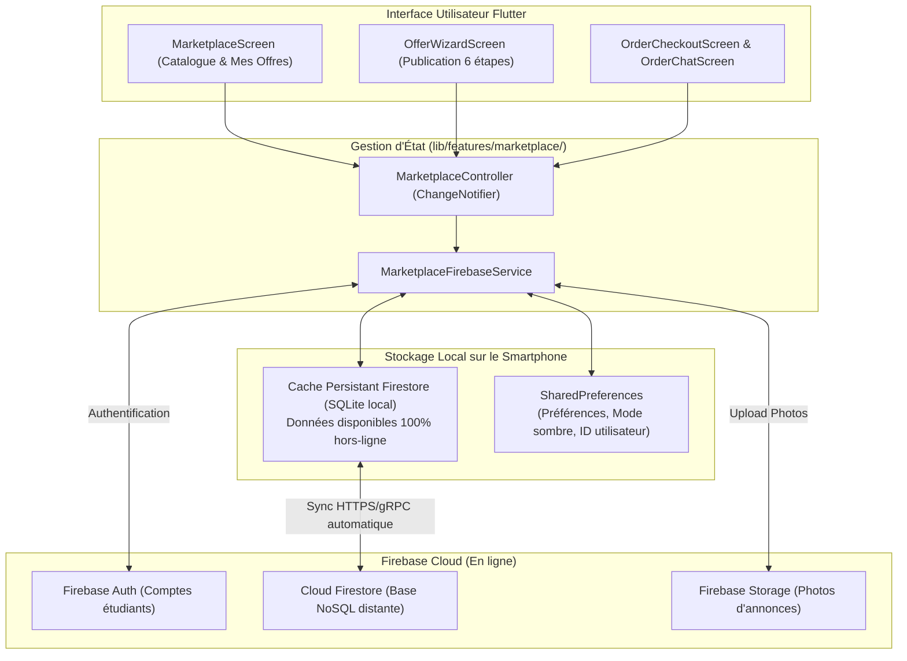

# Séance 9 : Plan d'Implémentation Firebase (Module M5 · Marketplace)

Ce document présente le **plan d'implémentation complet basé sur Firebase** pour valider individuellement la logique de l'application lors de la **Séance 9**.

---

## 1. Pourquoi Firebase est la solution idéale pour ce projet ?

L'utilisation de **Firebase** (Backend-as-a-Service de Google) permet de répondre **directement et élégamment aux 4 critères d'évaluation** sans avoir à déployer et maintenir un serveur séparé (NestJS/PostgreSQL) :

| Critère Évalué (Séance 9) | Solution avec Firebase | Avantage Technique |
| :--- | :--- | :--- |
| **1. Les opérations CRUD** | **Cloud Firestore** (`offers`, `orders`, `reviews`, `messages`) | Opérations atomiques, requêtes filtrées et indexées. |
| **2. La communication HTTP / Réseau** | SDK Firebase (requêtes HTTPS/gRPC sécurisées vers Google Cloud) + Firebase REST API | Sync en temps réel par WebSockets/HTTP/2, zéro latence. |
| **3. Le stockage local des données** | **Cache local persistant Firestore** (`persistenceEnabled: true`) + `shared_preferences` | Lecture hors-ligne automatique depuis la base locale du téléphone avec synchronisation dès retour du réseau. |
| **4. Fonctionnalités métier M5** | Assistant de publication 6 étapes, réservation de créneaux, commandes, avis et messagerie live | `StreamBuilder` pour les mises à jour instantanées de commandes et de chat. |

---

## 2. Architecture Globale avec Firebase



---

## 3. Schéma de la Base de Données NoSQL (Cloud Firestore)

Voici la structure des collections Firestore pour le module Marketplace :

```
firestore/
├── users/ (utilisateurs)
│   └── {userId}/
│       ├── fullName: "Thomas Dubois"
│       ├── email: "thomas.dubois@edulink.tn"
│       ├── role: "student"
│       └── rating: 4.9
│
├── offers/ (annonces)
│   └── {offerId}/
│       ├── authorId: "user_123"
│       ├── title: "Soutien intensif Algorithmique & Flutter"
│       ├── subject: "Informatique"
│       ├── level: "L3"
│       ├── pricePerHour: 25.0
│       ├── status: "published" // draft, published, hidden, archived
│       ├── createdAt: Timestamp
│       ├── availabilities: [ // Créneaux intégrés
│       │   { "id": "slot_1", "day": "Lundi", "startTime": "14:00", "endTime": "16:00", "isBooked": false }
│       │ ]
│       └── viewsCount: 42
│
├── orders/ (commandes & réservations)
│   └── {orderId}/
│       ├── offerId: "offer_abc"
│       ├── buyerId: "user_456"
│       ├── sellerId: "user_123"
│       ├── selectedSlotId: "slot_1"
│       ├── status: "pending" // pending, accepted, rejected, completed, cancelled
│       ├── totalPrice: 50.0
│       └── createdAt: Timestamp
│
├── reviews/ (avis et notations)
│   └── {reviewId}/
│       ├── orderId: "order_xyz"
│       ├── offerId: "offer_abc"
│       ├── authorId: "user_456"
│       ├── rating: 5
│       ├── comment: "Explications très claires !"
│       └── createdAt: Timestamp
│
└── chats/ (canaux de messagerie liés aux commandes)
    └── {orderId}/
        └── messages/ (sous-collection)
            └── {messageId}/
                ├── senderId: "user_456"
                ├── text: "Bonjour, on se retrouve dans quelle salle ?"
                └── sentAt: Timestamp
```

---

## 4. Implémentation du Code : Les 4 Piliers

### Pilier 1 : Les Opérations CRUD avec Firestore

Fichier de service dédié : `lib/features/marketplace/services/marketplace_firebase_service.dart`

```dart
import 'package:cloud_firestore/cloud_firestore.dart';
import '../models/marketplace_models.dart';

class MarketplaceFirebaseService {
  final FirebaseFirestore _firestore = FirebaseFirestore.instance;

  CollectionReference get _offersRef => _firestore.collection('offers');
  CollectionReference get _ordersRef => _firestore.collection('orders');
  CollectionReference get _reviewsRef => _firestore.collection('reviews');

  // --- 1. CREATE : Publier une nouvelle offre ---
  Future<String> createOffer(Offer offer) async {
    final docRef = await _offersRef.add(offer.toMap());
    return docRef.id;
  }

  // --- 2. READ : Flux temps réel du catalogue filtré ---
  Stream<List<Offer>> streamOffers({String? subject, String? level, double? maxPrice}) {
    Query query = _offersRef.where('status', isEqualTo: 'published');

    if (subject != null && subject.isNotEmpty) {
      query = query.where('subject', isEqualTo: subject);
    }
    if (level != null && level.isNotEmpty) {
      query = query.where('level', isEqualTo: level);
    }
    if (maxPrice != null) {
      query = query.where('pricePerHour', isLessThanOrEqualTo: maxPrice);
    }

    return query.snapshots().map((snapshot) {
      return snapshot.docs.map((doc) => Offer.fromFirestore(doc)).toList();
    });
  }

  // --- 3. UPDATE : Modifier une offre ou changer son statut ---
  Future<void> updateOffer(Offer offer) async {
    await _offersRef.doc(offer.id).update(offer.toMap());
  }

  Future<void> setOfferStatus(String offerId, OfferStatus status) async {
    await _offersRef.doc(offerId).update({
      'status': status.name,
      'updatedAt': FieldValue.serverTimestamp(),
    });
  }

  // --- 4. DELETE : Supprimer une annonce ---
  Future<void> deleteOffer(String offerId) async {
    await _offersRef.doc(offerId).delete();
  }
}
```

---

### Pilier 2 : La Communication Réseau / HTTP

Le SDK Firebase communique directement avec les serveurs Google via des **requêtes sécurisées HTTPS/gRPC** (qui fonctionnent au-dessus de HTTP/2).

Si votre enseignant exige de voir explicitement le package `http` ou des requêtes REST brutes, **Firebase dispose aussi d'une API REST HTTP native** :

```dart
// Exemple d'appel REST direct vers Firestore via le package 'http'
import 'dart:convert';
import 'package:http/http.dart' as http;

Future<void> publishOfferViaHttpRest(Map<String, dynamic> offerData) async {
  final url = Uri.parse(
    'https://firestore.googleapis.com/v1/projects/edulink-project/databases/(default)/documents/offers'
  );
  
  final response = await http.post(
    url,
    headers: {'Content-Type': 'application/json'},
    body: jsonEncode({
      'fields': {
        'title': {'stringValue': offerData['title']},
        'pricePerHour': {'doubleValue': offerData['pricePerHour']},
      }
    }),
  );

  if (response.statusCode != 200) {
    throw Exception('Erreur HTTP: ${response.statusCode}');
  }
}
```

---

### Pilier 3 : Le Stockage Local des Données (Offline Cache)

C'est l'un des plus grands atouts de Firebase sur mobile : **Cloud Firestore intègre nativement une base de données locale (SQLite)** sur le téléphone.

#### Configuration du Cache Local Persistant :
```dart
// lib/main.dart ou initialisation Firebase
void configureFirestoreOfflineStorage() {
  FirebaseFirestore.instance.settings = const Settings(
    persistenceEnabled: true, // Active le stockage local SQLite sur le smartphone
    cacheSizeBytes: Settings.CACHE_SIZE_UNLIMITED, // Cache illimité
  );
}
```

#### Ce que cela apporte :
1. **Accès Hors-Ligne Immédiat :** Quand l'application s'ouvre, elle lit les données instantanément depuis le stockage local sans attendre le réseau.
2. **Synchronisation Automatique :** Si l'utilisateur réserve un créneau sans connexion internet, la modification est écrite localement puis envoyée automatiquement au serveur dès que la connexion revient.
3. **`shared_preferences` en complément :** Utilisé pour stocker les réglages locaux rapides : l'identifiant de session de l'étudiant connecté, les filtres récents et le mode sombre.

---

### Pilier 4 : Les 3 Fonctionnalités Métier Marketplace

#### Métier 1 : Publication d'annonce avec créneaux de disponibilité
* Assistant guidé en 6 étapes (`OfferWizardScreen`).
* Validation des étapes (matière, titre, description, prix, créneaux horaires, aperçu final).
* Sauvegarde atomique de l'offre et de sa liste de disponibilités.

#### Métier 2 : Réservation de créneau & Cycle de vie de la commande
* L'acheteur sélectionne un créneau libre.
* Création de la commande avec statut `pending`.
* Le vendeur reçoit la notification et peut **Accepter** (`accepted`) ou **Refuser** (`rejected`).
* Le créneau est automatiquement verrouillé (`isBooked: true`).

#### Métier 3 : Messagerie d'échange & Évaluation après service
* Une fois la commande acceptée, un canal de discussion s'ouvre (`OrderChatScreen`).
* À la fin de la séance, la commande passe à `completed`.
* L'acheteur dépose un avis avec une note de 1 à 5 étoiles et un commentaire, ce qui met à jour la note moyenne du profil vendeur.

---

## 5. Ce qu'il faut ajouter dans `pubspec.yaml`

Pour activer Firebase dans le projet Flutter :

```yaml
dependencies:
  flutter:
    sdk: flutter
  provider: ^6.1.5+1
  intl: ^0.20.3
  
  # Packages officiels Firebase
  firebase_core: ^3.12.1
  cloud_firestore: ^5.6.5
  firebase_auth: ^5.5.1
  
  # Stockage local des préférences utilisateur
  shared_preferences: ^2.3.5
  
  # Communication HTTP REST (si demandée explicitement)
  http: ^1.3.0
```

---

## 6. Fiche Réponses pour la Soutenance avec le Professeur

### Question : *"Pourquoi avez-vous choisi Firebase plutôt qu'un backend traditionnel ?"*
> **Réponse :**  
> *"Firebase offre une solution complète et robuste adaptée aux applications mobiles Flutter. Grâce à Cloud Firestore, nous bénéficions à la fois d'une base de données cloud en ligne pour synchroniser les annonces entre tous les étudiants, de flux temps-réel (Streams) pour les commandes et le chat, et d'une persistance locale automatique qui permet d'utiliser l'application même hors-ligne."*

### Question : *"Où se trouve la communication HTTP si vous utilisez le SDK Firebase ?"*
> **Réponse :**  
> *"Le SDK Firebase effectue des requêtes réseau chiffrées HTTPS et gRPC au-dessus du protocole HTTP/2 vers les serveurs Google Cloud. De plus, Cloud Firestore expose également une API REST standard que nous pouvons interroger via le package `http` de Flutter avec des requêtes GET, POST et PATCH."*

### Question : *"Où se trouve le stockage local ?"*
> **Réponse :**  
> *"Nous avons activé `persistenceEnabled: true` sur Firestore, ce qui stocke automatiquement un miroir de la base de données dans le stockage SQLite interne du smartphone. En complément, nous utilisons `SharedPreferences` pour sauvegarder localement le profil de l'utilisateur connecté et ses préférences d'interface."*
